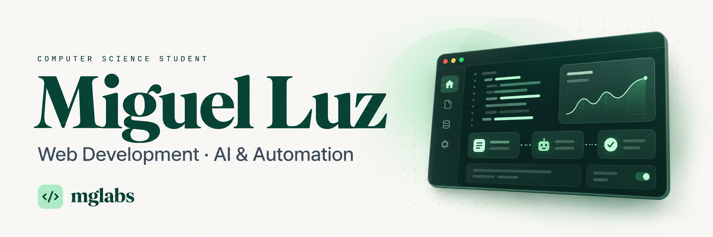

  

Miguel Luz
Computer Science Student · Full-Stack Development · AI & Automation
Building web experiences and practical automations for real businesses.
Goiânia, Brazil · PUC Goiás · Creator of MGLabs

About
I'm a Computer Science student at PUC Goiás, an IT intern at GoiásFomento, and a freelance developer behind MGLabs.
My work brings together web development, interface design, and process automation. I've built websites for businesses in executive aviation and legal services, and I work with AI-assisted documents, spreadsheets, and management dashboards during my internship.
I use AI throughout my development workflow while studying, reviewing, and understanding the code I ship. My focus is on clear interfaces, thoughtful interactions, and solutions that make everyday work easier.
Selected work
HM2 Aviation
A website for executive aircraft sales and import advisory.
- Aircraft listings with image galleries and detailed specifications.
- A custom image optimization pipeline using sharp.
- A Vite plugin that pre-renders a page for each aircraft for social link previews.
- An inertial draggable carousel, Flip transitions, and text animations with GSAP.
React 19 TypeScript Vite Tailwind CSS GSAP Netlify
Explore the website ↗
Moraes Luz Advocacia
An institutional website for a law firm and legal advisory practice.
- Responsive presentation of the firm's background and practice areas.
- Component-based development with React and TypeScript.
- Hero, card, and mobile navigation animations with Motion.
- A green and gold visual identity with direct contact paths.
React 19 TypeScript Vite Tailwind CSS 4 Motion Lucide React Netlify
Explore the website ↗
MGLabs
My independent web development initiative.
I create websites and landing pages for businesses, combining responsive interfaces, purposeful motion, and a straightforward delivery process. The MGLabs website presents my services, selected client work, and approach to building for the web.
Visit MGLabs ↗
Experience
IT Intern · GoiásFomento — GELIC
March 2026 — Present
- AI-assisted document workflows involving data extraction, template completion, and verification.
- Participation in the development of an AI agent for direct procurement processes.
- Automated spreadsheets for contract tracking and deadline alerts.
- Data extraction, consolidation, and management dashboards.
- Technical documentation and support for administrative workflows.
In progress
Project	Focus	Status
Legal workflow automation	Organizing court publications, removing duplicates, and exploring deadline tracking and urgency classification.	In development
MG Fit	A fitness application — Fitness Operating System.	In progress

Technical toolkit
Languages

  

Front-end

  

GSAP · Motion · Lucide React · Responsive design · Image optimization
Back-end & databases

  

Tools & workflow

  

Claude Code · Google AI Studio · Prompt engineering · AI agents · Excel · LaTeX
Currently learning
- Next.js and application architecture.
- Docker and reproducible development environments.
- Advanced TypeScript and maintainable component design.
- Clean Architecture and separation of responsibilities.
- AI agents and practical workflow integrations.
Education
B.Sc. in Computer Science · PUC Goiás
2025 — Expected graduation: 2029
Coursework includes data structures, object-oriented programming, databases, computer architecture, and computational linear algebra.
Systems Programming · SENAC GO
Completed in 2025 · 200 hours
Let's connect
I'm interested in opportunities in software development, automation, and data, as well as freelance web projects.
- Email: miguelmluz777@gmail.com
- LinkedIn: linkedin.com/in/miguelluz19
- MGLabs: mglabss.netlify.app

  Understand the problem. Build with intention. Keep learning.

